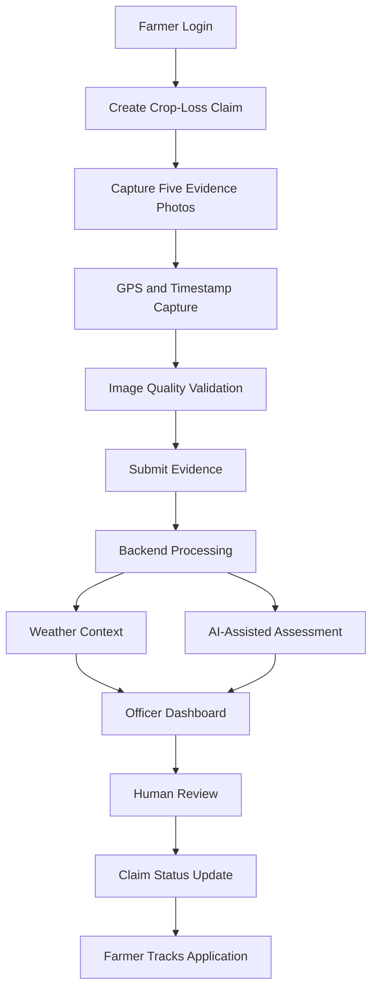

# 🌾 FarmProof
### Evidence-driven crop loss reporting and assessment support

<p align="center">
  <strong>Capture evidence. Verify context. Support better decisions.</strong>
</p>

<p align="center">
  
  
  
</p>

<p align="center">
  <a href="https://github.com/kumarinsitute-stack/FarmProof">Repository</a> •
  <a href="https://github.com/kumarinsitute-stack/FarmProof/issues">Issues</a> •
  <a href="https://github.com/kumarinsitute-stack/FarmProof/pulls">Pull Requests</a>
</p>

---

## 👥 Team Nexus.DTU

**Team Leader:** Sameer Raja

**Team Members:**
- Gaurav Kumar
- Akshat Bhati
- Naynika Rani

---

## 1. Overview

**FarmProof** is an agricultural technology platform designed to improve how crop-loss evidence is collected, organized and reviewed.

When crops are damaged by floods, excessive rainfall or other adverse conditions, farmers may struggle to provide clear, properly documented evidence. Field verification can also involve fragmented information and manual processes.

FarmProof addresses this challenge through a digital evidence-capture and assessment-support workflow.

The platform connects farmers and officers through a unified system that combines:

- Structured crop-damage photography.
- GPS-based location capture.
- Timestamped evidence documentation.
- Image-quality validation.
- Weather-context integration.
- AI-assisted damage assessment.
- Officer review and claim tracking.

**Our goal:** Make crop-loss documentation more structured, transparent and accessible.

## 2. The Problem

Crop-loss reporting and verification can face several challenges:

| Challenge | Impact |
|---|---|
| Incomplete photographic evidence | Difficulties during verification |
| Missing or inaccurate location details | Uncertainty about the affected field |
| Poor-quality photographs | Reduced usefulness of submitted evidence |
| Disconnected weather information | Additional effort during assessment |
| Manual review workflows | Time-consuming information organization |
| Limited claim visibility | Difficulty tracking application progress |

FarmProof aims to bring these elements into one coordinated workflow.

## 3. Key Features

### 👨‍🌾 Farmer Portal

- Farmer registration and login.
- Guided crop-loss evidence submission.
- Five structured photographic evidence slots.
- Camera-based image capture.
- GPS location acquisition.
- Claim submission and status tracking.
- Mobile-friendly interface.

### 📸 Structured Evidence Capture

FarmProof organizes evidence into five required categories:

| Slot | Evidence category |
|---|---|
| 01 | Wide view of the affected field |
| 02 | Root-zone inundation or crop damage |
| 03 | Crop canopy close-up |
| 04 | Field landmark or cadastral reference |
| 05 | Farmer identification document |

The evidence workflow is designed to enforce one active photograph per slot.

Additional validation includes:

- Image blur and quality analysis.
- Image dimension and exposure checks.
- Duplicate-image detection.
- Capture metadata.
- Timestamp and location watermarking.
- Original-image preservation alongside processed derivatives.

### 📍 Geolocation and Field Verification

- Browser-based GPS acquisition.
- Location coordinates and accuracy information.
- Geographic visualization using interactive maps.
- Field-location context for officer review.

Location information is recorded as supporting evidence; GPS coordinates alone do not establish ownership or prove that damage occurred at a particular location.

### 🌦️ Weather Context

FarmProof integrates weather information through Open-Meteo to provide additional environmental context.

Weather information can help reviewers examine conditions such as:

- Rainfall.
- Precipitation patterns.
- Wind conditions.
- Historical weather context.

Weather data is intended for corroboration and does not independently prove the cause of crop damage.

### 🤖 AI-Assisted Damage Assessment

The platform incorporates AI-assisted analysis to help organize and interpret submitted crop-damage evidence.

The assessment workflow supports damage-severity categorization:

| Severity | Indicative damage range |
|---|---:|
| Marginal | Below 30% |
| Moderate | 30–70% |
| Severe | Above 70% |

These categories are indicative assessment outputs, not official insurance determinations.

**Human oversight remains essential.** AI-generated results are intended to assist reviewers, not automatically approve, reject or settle claims.

### 🧑‍💼 Officer Dashboard

The officer interface provides tools for:

- Viewing submitted claims.
- Inspecting uploaded photographs.
- Reviewing location and weather context.
- Examining AI-assisted assessment results.
- Updating claim-review status.
- Tracking evidence and application information.

## 4. How FarmProof Works



## 5. Technology Stack

| Layer | Technologies |
|---|---|
| Frontend | React 19, TypeScript |
| Build Tool | Vite |
| Styling | Tailwind CSS |
| Backend | Node.js, Express |
| Mapping | Leaflet, OpenStreetMap |
| AI Integration | Google Gemini API |
| Weather Context | Open-Meteo API |
| Development Runtime | TypeScript, TSX |
| Testing | Python test scripts |

## 6. System Architecture

FarmProof follows a client-server architecture.

**Frontend**
- Provides farmer and officer interfaces.
- Handles camera interactions and location permissions.
- Displays submitted evidence, maps and assessment information.

**Backend**
- Exposes application APIs through Express.
- Processes evidence submissions.
- Applies validation rules.
- Coordinates external data and AI integrations.

**Evidence Processing**
- Validates image requirements.
- Analyzes image quality.
- Generates image hashes.
- Creates timestamped image derivatives.

**External Integrations**
- Open-Meteo for weather context.
- Google Gemini for AI-assisted analysis.
- OpenStreetMap ecosystem for map visualization.

## 7. Getting Started

### Prerequisites

Make sure you have installed:

- [Node.js](https://nodejs.org/)
- npm
- Git
- Python 3 (for running Python-based tests)

### Clone the repository

```bash
git clone https://github.com/kumarinsitute-stack/FarmProof.git
cd FarmProof
```

### Install dependencies

```bash
npm install
```

### Configure environment variables

Create a `.env` file in the project root.

```env
GEMINI_API_KEY=your_gemini_api_key
APP_URL=http://localhost:3000
```

Refer to `.env.example` and the current backend implementation for the required configuration.

Never commit real API keys, credentials or private environment files.

### Start the development server

```bash
npm run dev
```

### Build for production

```bash
npm run build
```

### Run the production server

```bash
npm run start
```

### Run TypeScript checks

```bash
npm run lint
```

## 8. Deployment

FarmProof can be deployed using a Node.js-compatible hosting platform such as Render.

General deployment configuration:

| Setting | Value |
|---|---|
| Runtime | Node.js |
| Build command | `npm install && npm run build` |
| Start command | `npm run start` |
| Environment | Configure required environment variables |
| Branch | Select the intended deployment branch |

Make sure the deployed service has the required environment variables and that uploaded evidence is stored persistently. A production deployment should use persistent or object storage rather than relying on an ephemeral local filesystem.

## 9. Project Structure

```text
FarmProof/
│
├── public/                  # Static assets
├── data/                    # Application data
├── uploads/                 # Local evidence uploads
│
├── server/
│   └── dataStore.ts         # Data storage utilities
│
├── src/
│   ├── components/
│   │   ├── DirectCameraModal.tsx
│   │   ├── FarmerCapture.tsx
│   │   ├── FarmerDashboard.tsx
│   │   ├── FarmerLogin.tsx
│   │   ├── FarmerTracker.tsx
│   │   ├── OfficerDashboard.tsx
│   │   └── RealLeafletMap.tsx
│   │
│   ├── services/
│   │   ├── evidenceKit.ts
│   │   ├── geolocation.ts
│   │   └── offlineQueue.ts
│   │
│   ├── App.tsx
│   ├── api.ts
│   ├── mockData.ts
│   ├── translations.ts
│   └── types.ts
│
├── server.ts
├── test_comprehensive.py
├── test_evidence_capture.py
├── package.json
├── vite.config.ts
└── README.md
```

## 10. Security and Data Integrity

FarmProof is designed with evidence integrity and responsible data handling in mind.

Important considerations include:

- Keep API credentials outside source control.
- Validate uploaded files on the server.
- Enforce file-size and evidence-slot requirements.
- Preserve original uploaded images.
- Separate original evidence from processed image derivatives.
- Restrict access to farmer and officer information.
- Avoid treating AI output or weather information as conclusive proof.

Production use requires appropriate authentication, authorization, secure storage, retention policies and privacy safeguards.

## 11. Limitations and Disclaimer

FarmProof is an evolving prototype intended to support crop-loss evidence documentation and assessment workflows.

- It is not an official government insurance portal.
- It does not independently approve or reject insurance claims.
- AI-generated severity categories are advisory.
- Weather information is contextual, not proof of causation.
- GPS metadata does not independently establish land ownership or image authenticity.
- Government compensation or insurance payouts are not processed by FarmProof.

Final decisions remain with the relevant authorized authorities and insurance processes.

## 12. Contributing

Contributions, suggestions and technical feedback are welcome.

1. Fork the repository.
2. Create a feature branch.
3. Make your changes.
4. Test your implementation.
5. Submit a pull request with a clear description.

```bash
git checkout -b feature/your-feature
git add .
git commit -m "Describe your changes"
git push origin feature/your-feature
```

## 13. License

No license has been confirmed in the repository. Please add an appropriate `LICENSE` file before describing FarmProof as open-source software.

---

<p align="center">
  <strong>FarmProof — Better Evidence. Better Assessment. Stronger Agricultural Support.</strong>
  <br/>
  Built by Team Nexus.DTU 🌾
</p>
